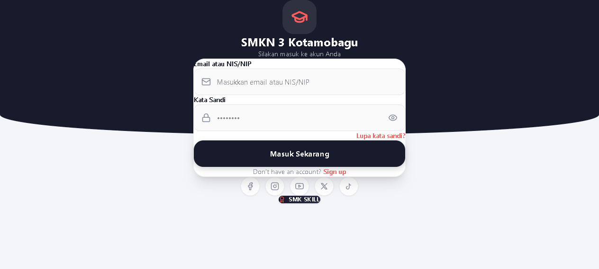

# SMK3 Absensi

**Live:** https://pr.smkn3kotamobagu.sch.id

Digital attendance system used at SMKN 3 Kotamobagu for teachers, administrative staff and students. This repository is a showcase only. The source is private because it belongs to a school and handles personal data.

## What it does
- Check-in with identity, in-browser face recognition (face-api.js) and GPS geofencing
- Roles: admin, principal, teachers, administrative staff, students, homeroom teachers, parents
- Leave requests with approval flow, holiday management, attendance recaps and reports
- WhatsApp notifications (KirimDev / Fonnte)
- Installable PWA, plus a companion Expo / React Native app

## Stack
Next.js 16 (App Router) · React 19 · TypeScript · Tailwind CSS v4 · Supabase (PostgreSQL, Auth, Row Level Security) · Server Actions · Expo React Native · Vercel

## Engineering notes
Product requirements document, deployment guide, user manual (Juknis), security hardening migrations and a technical-debt audit were written for the project.
